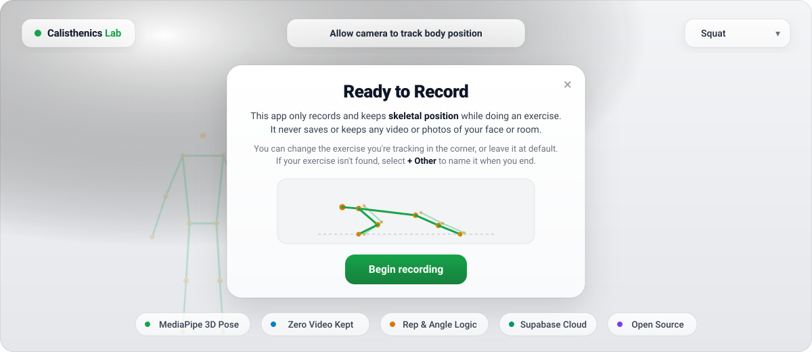

<p align="center">
  <picture>
    <source media="(prefers-color-scheme: dark)" srcset="assets/banner-dark.svg">
    
  </picture>
</p>

<p align="center">
  <a href="https://detractless.github.io/calisthenics-lab/"><b>Try Live Demo (GitHub Pages)</b></a> ·
  <a href="#how-a-rep-is-counted"><b>How It Works</b></a> ·
  <a href="#database--supabase-setup"><b>Supabase Setup</b></a> ·
  <a href="#license"><b>MIT License</b></a>
</p>

<p align="center">
  
  
  
  
</p>

# Calisthenics Lab

Browser-only rep counter for squats, push-ups and pull-ups. MediaPipe Pose
Landmarker tracks the body on your device. The camera picture is never shown,
saved or uploaded: the screen shows only a skeleton.

## Run it

```
npm start        # serves http://localhost:8000
npm test         # rep-counter, elbow-angle and knee-angle tests (Node 20+)
```

1. Press **Allow camera to track body position** (top centre).
2. The dialog appears explaining tracking privacy and instructions. Pick your exercise in the dropdown at the top right (default Squat) or pick **+ Other**.
3. Press **Begin recording**, get in position during the 3-second countdown, do your
   set, press **Stop**.
4. The camera turns off, the rep count appears in a glass panel, and a
   landmarks CSV downloads and is shared with the community library in Supabase.

Recording stops by itself after 3 minutes. The camera needs `localhost` or
`https://` (GitHub Pages is fine). Keep your whole body in view.

**+ Other** is for any exercise not in the list: it records the CSV only and
lets you name the exercise at the end of the set.

## Database & Supabase setup

Anonymous workout coordinate recordings are stored in Supabase:
- Run the SQL in `supabase/schema.sql` inside the Supabase SQL editor to create the `recordings` table with Row Level Security (RLS) enabled.
- Anonymous visitors can insert new recordings, but cannot read or delete existing submissions.

## How a rep is counted

1. MediaPipe gives 33 body points per camera frame.
2. A joint angle is computed from the 3D world points: knee (hip-knee-ankle)
   for squats, elbow (shoulder-elbow-wrist) for push-ups and pull-ups. Limbs
   the camera cannot see clearly are ignored.
3. A rep starts when the joint leaves "straight" and counts when it reaches
   "bent". The joint must straighten again before the next rep. The angles
   per exercise are in `src/reps/exercises.js` (squat 160° / 110°,
   push-up and pull-up 150° / 100°).
4. Statuses: **valid**, **review** (tracking unreliable mid-rep), **partial**
   (dipped but never reached "bent", not counted).

## Landmarks CSV

`time_ms,joint,x,y,z,visibility,world_x,world_y,world_z`. Body points only: the
eye, ear and mouth points are left out. The nose is kept.

## Layout

- `src/tracking/` MediaPipe, camera access, joint angles
- `src/reps/` exercise list and rep counting
- `src/page/` the page: wiring, camera session, dropdown, results, skeleton, CSV, Supabase
- `supabase/` database schema and RLS policies
- `tests/` Node tests for the counting and angle maths

## License

[MIT](LICENSE)
